# MY MOCHI

> 모찌 친구와 함께, 매일 작은 미션으로 **밖에 한 발 나가고 · 하루를 기록하고 · 사람과 가볍게 이어지는** 게임형 앱

캡스톤 프로젝트

| 이름 | 역할 |
|---|---|
| **윤경** (`alicena2ppn2`) | PM · 기획 · 백엔드(서버 · 연결 · 배포) · 프론트엔드(화면 다듬기) · 데이터 분석 |
| **영주** (`yeongju217`) | 기획 · 프론트엔드(웹 · 앱) · 디자인(캐릭터 · 화면) · 데이터 분석 |

---

## 1. 앱 소개

**위험한 사람을 찾아내는 앱이 아니라**, 관계 맺기와 일상 활동이 어려운 사람에게 **지금 할 수 있는 작은 행동과 가벼운 만남을 게임처럼 건네고, 어떻게 하면 되는지까지 알려 주는 앱**이다. 목표는 검증하기 어려운 "예방"이 아니라 측정할 수 있는 **"활동과 교류를 늘리기"**.

- **대상**: 외로움, 오랜만의 만남이 어색함, 집에 있는 시간이 늘어 활동이 줄어든 **비교적 가벼운 단계**. 정신질환·트라우마·심한 우울은 전문 기관의 영역 → 진단·치료·상담을 하지 않고 **도움받을 곳을 안내**한다.
- **자리**: 심리적 회복 → **(MOCHI)** → 사회적 회복 → 사회적 통합. 상담과 공공 지원 사이의 "작게 움직이고 가볍게 만나는" 단계.
- **근거** (자세한 표는 [APP_INTRO.md](APP_INTRO.md)):
  - 외로움이 이후의 우울을 예측한다 (Cacioppo 2010)
  - 활동이 거의 없던 사람이 **조금만 늘려도** 우울 위험이 가장 많이 줄어든다 (Pearce 2022)
  - 하루 1,000보 늘 때마다 우울 위험 9% 낮음 (Bizzozero-Peroni 2024)
  - 자연에서 주 120분, 짧게 여러 번이어도 됨 (White 2019)
  - 포켓몬고는 실제 걸음을 하루 약 1,500보 늘렸지만 몇 주 만에 효과가 줄었다 → **매일 바뀌는 미션·수집·이웃 연결로 오래 이어 가게** 설계
- **비슷한 앱과 다른 점**: Finch(스스로 체크·외출 초점 없음), 피크민 블룸(이미 걷는 사람 중심), Habitica(실패하면 벌), 상담 앱(이미 도움을 찾는 사람 대상)과 달리 → **아주 작은 외출부터 · 사진·걸음으로 확인되는 행동에만 보상 · 벌점 없음 · 가벼운 연결 · 도움받을 곳 안내**
- **하지 않는 것**: 위험 점수·"위험군" 라벨, 일기 분석으로 마음 상태 평가, 전문 상담·개입. 이 연구들은 대부분 **관련성**이며 MOCHI 자체의 효과는 사용 데이터로 따로 확인해야 한다.

## 화면

앱(Expo, iPhone 크기 390×844) · 시연 계정 기준

| **홈 — 모찌와 내 방** | **연속 출석 (1~7일차)** | **오늘의 도전 — 데일리 미션** | **오늘의 활동 — 사진으로 완료** |
|---|---|---|---|
| 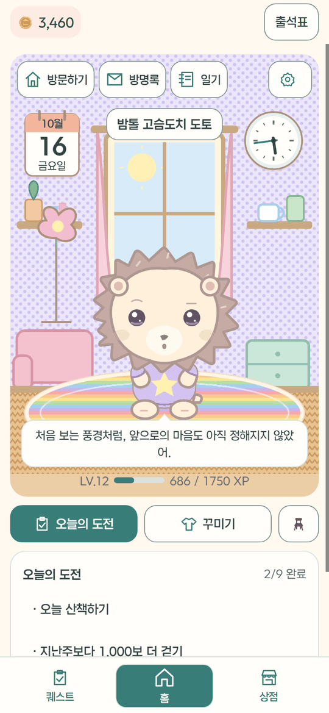 | 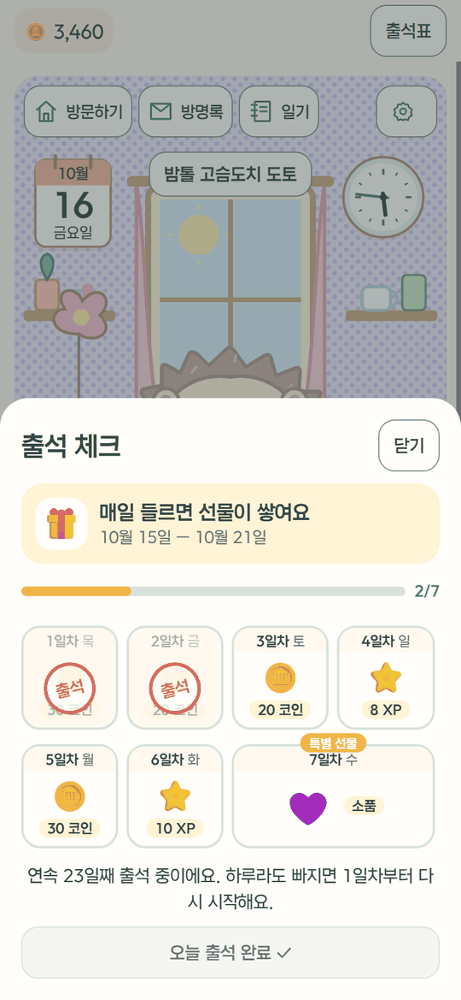 | 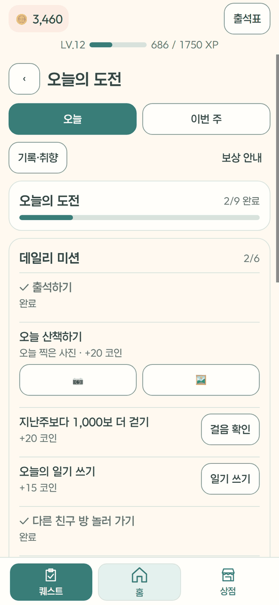 | 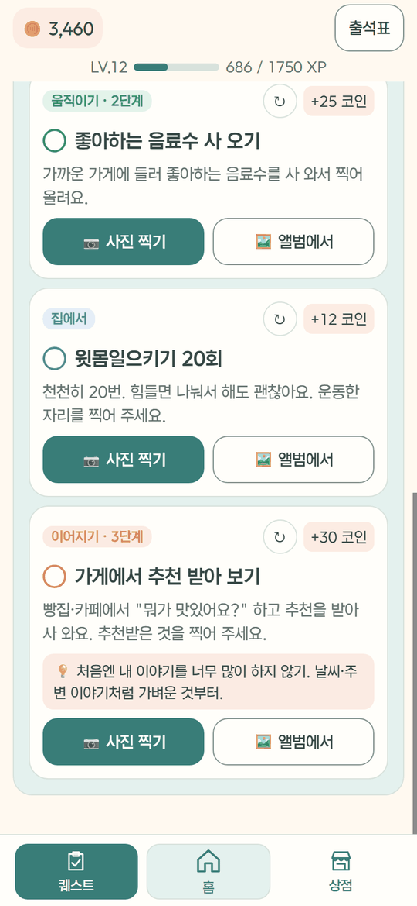 |
| **상점 — 친구 캐릭터** | **상점 — 집 꾸미기** | **이웃 — 비슷한 레벨 추천** | **친구 코드로 찾기·신청** |
| 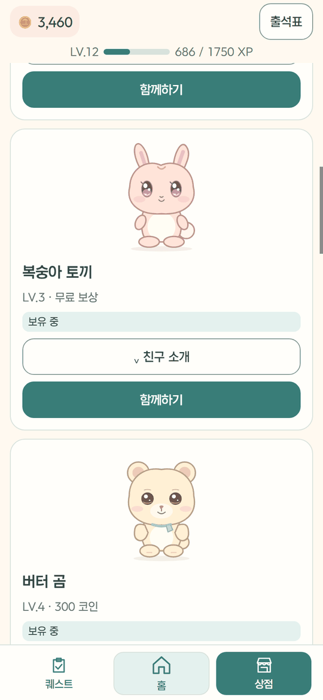 | 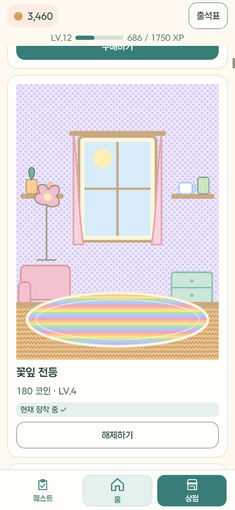 | 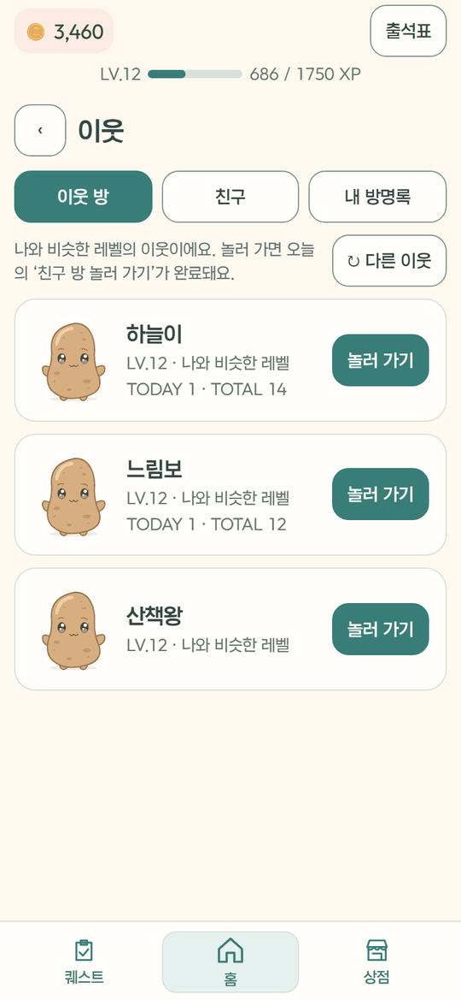 | 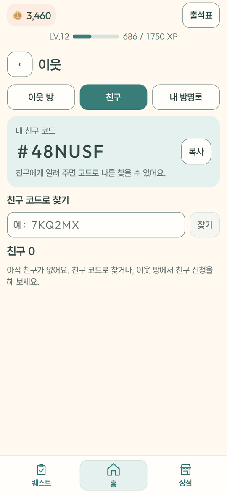 |
| **이웃 방 놀러 가기·친밀도** | **방명록 신고 창** | **일기** | **설정 — 내 프로필** |
| 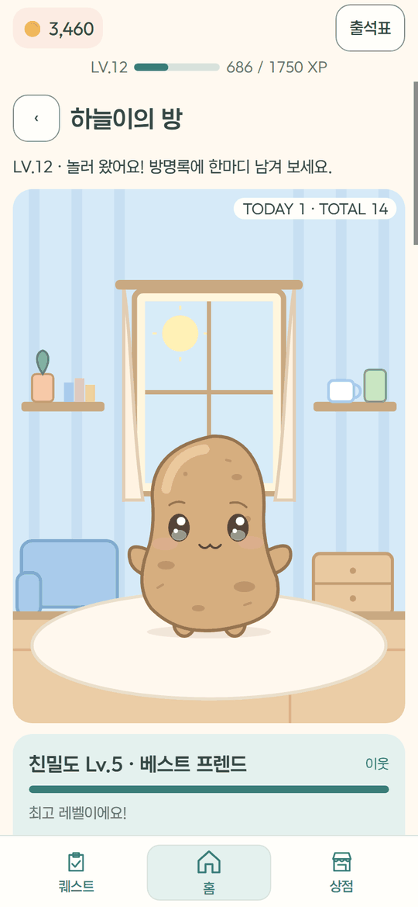 | 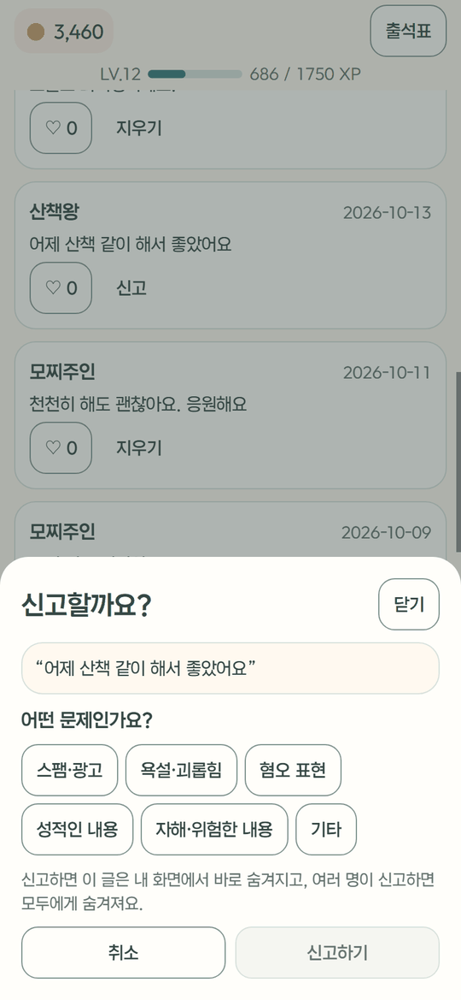 | 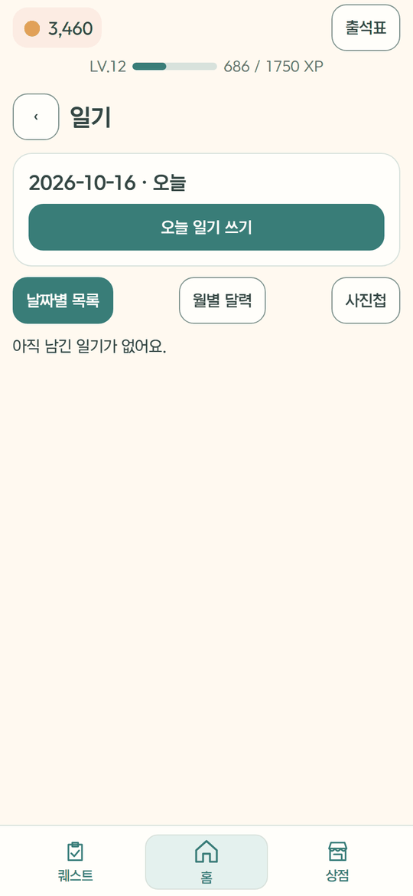 | 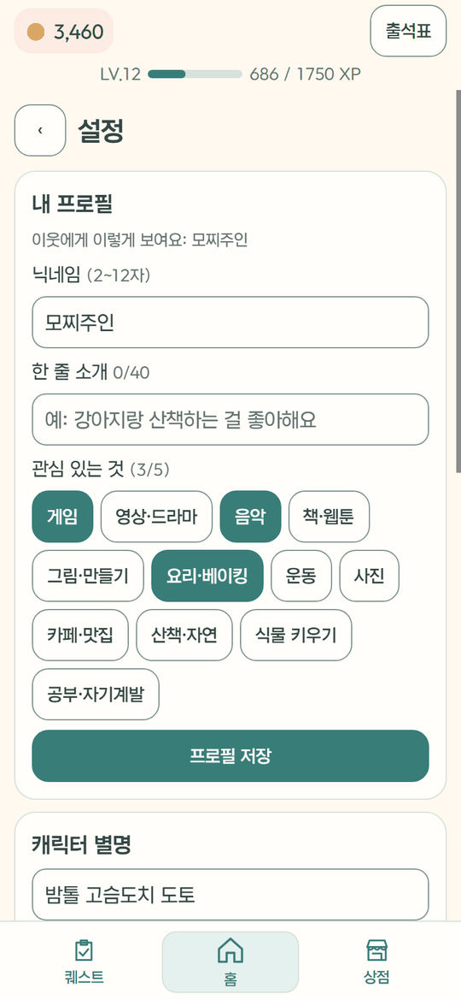 |

## 2. 제품 가이드 

**한 문장**: 작은 일상 활동과 하루 기록을, 모찌 친구와 함께 이어 가는 게임형 앱.

**핵심 가치 세 가지**
1. **친구와 함께하는 재미** — 숫자만 올리는 성장 대신 새 친구를 만나고 옷과 방을 꾸민다
2. **내 생활에서 시작하는 작은 활동** — 처음 설문(직업·관심사·외출 빈도)으로 원래 하던 일에 "조금 더"
3. **남겨 두는 하루와 가벼운 연결** — 일기·사진으로 하루를 돌아보고, 이웃 방 방문·방명록으로 말을 건넬 계기

**하루 흐름**

```text
앱 열기 → 연속 출석 (1~7일차 선물)
  → 홈: 모찌와 방, 오늘의 문장, 오늘의 도전
  → 밖에 나가 사진 찍기 · 걸음 채우기 → 오늘 찍은 사진이면 완료
  → 동네 탐험: GPS로 가까운 장소·거리 확인 → 지도 → 장소에 도착하면 쪽지 남기기 (읽기는 어디서나)
  → 코인·XP → 레벨업 → 상점에서 친구·옷·집 꾸미기
  → 이웃 방 놀러 가서 방명록 한 줄 · 친구 신청
  → 오늘의 주제로 일기 → 사진첩에 하루가 쌓임
```

**말투·원칙**: 숫자로 판단을 통보하지 않는다("위험도 82점" ✕ → "오늘 15분 걸어 볼까요?" ○), 부담은 5분 크기부터, 실패해도 벌점 없음, 사진 확인은 서버 안에서 조용히.

## 3. 퀘스트 설계

검증된 심리학 개입 방법을 게임으로 옮긴다. 자세한 근거는 [QUEST_DESIGN.md](QUEST_DESIGN.md).

| 원리 | 근거 | 앱에서 |
|---|---|---|
| **행동 활성화** | Ekers 2014 (무작위 대조 시험 26편, 효과 크기 0.74) | 작은 활동 고르기 → 하기 → **"해 보니 어땠어?" 기분 한 줄**(소감) |
| **"평소 하던 것 + 조금 더"** (교수님 면담) | 새 활동이 많으면 부담 | 처음 설문으로 하던 일 기반 미션, 정적인 미션 줄이고 몸을 움직이는 집 미션 |
| **성취감 × 소속감** | 생산적이면서 누군가와 이어지는 활동이 기분을 가장 올림 | 가족 식사 차리기, 단골 가게 가기, 강아지 산책하며 인사 |
| **사회 기술 팁 카드** | PEERS 등 "구체적인 방법을 가르치는" 방식 | 교류 미션마다 "이렇게 해 보세요" (질문 하나 하기, 휴대폰 내려놓기 …) |
| **단계 사다리** | 일본 히키코모리 지원 단계 | 혼자 → 한 명 → 여럿 (1~3단계, 지역은 뺌). 3번 하면 다음 단계, 내려가지 않음 |
| **약한 연결·말 걸기** | Sandstrom·Dunn 2014, Epley·Schroeder 2014 | 이웃 방 방문, 방명록, 짧은 인사 미션 |
| **주간 자연 산책** | White 2019 | 이번 주 공원·하천 사진 서로 다른 날 2번 |

**하루 미션**: 데일리 미션 5개(출석 · 산책하기 · 지난주보다 1,000보 더 걷기 · 일기 쓰기 · 다른 친구 방 놀러 가기) + **오늘의 활동 3개**(움직이기 · 집에서 · 이어지기, 하루 3번 다른 미션으로 바꾸기) + 주간 미션 1개. 미션은 사진(그날 찍은 것), 걸음, 서버가 확인하는 방문, 또는 인사·안부·운동처럼 사진이 어색한 미션은 **"했어요" 체크**로 완료한다. 방명록은 매일 미션이 아니고 원할 때 남긴다.

퀘스트 코드가 어느 파일에 있는지는 [6-2 미션 → 퀘스트 파일 위치](#퀘스트-파일-위치).

**보상 원칙**: 밖에 나가는 미션이 가장 크고(20코인) 집 미션(12코인)·스스로 체크(5코인)는 작게, 실패·미완료는 벌점 없음. 상점 가격은 그대로 두고 "사는 데 며칠 걸리나"로 맞췄다 — 소품 1일 · 옷 2~3일 · 친구 2~6일 · 상점 전체 3~4달 ([backend/ECONOMY.md](backend/ECONOMY.md)).

## 4. 규모

서버 API 70개 · 미션 91개(데일리 5 + 바뀌는 86) · 일기 주제 50개 · 상점 친구 12 · 옷 9 · 집 꾸미기 46 · 테스트 백엔드 277개 · 앱·공통 134개

## 5. 폴더 및 실행

| 폴더 | 무엇 | 실행 |
|---|---|---|
| `backend/` | Python FastAPI + SQLite 서버 — 게임 규칙의 기준 | `cd backend` → `.venv/Scripts/python scripts/serve.py --port 8000` (테스트: `python -m pytest`) |
| `mobile/` | Expo SDK 57 · React Native 0.86 — **출시할 iOS·Android 앱** | `cd mobile` → `npm run web -- --port 5183` (웹 미리보기) · 실기기는 EAS 개발 빌드 |
| `frontend/` | React 19 + Vite 7 웹 — 화면 확인·시연용 | `cd frontend` → `npm run dev -- --port 5180` |
| `shared/` | 앱·웹이 같이 쓰는 게임 규칙·데이터·그림·로그인 코드 | (따로 실행하지 않음) `cd mobile` → `npm run test:all` |
| `data/` | 합성 생활 데이터, 분석 노트북 | — |

- 개발할 때 `backend/.env`에 `CAPSTONE_AUTH=dev`를 넣으면 로그인 없이 시연 계정(demo-mochi)으로 볼 수 있다. 시연 데이터: `backend/scripts/seed_demo.py`

**배포**: 서버는 Railway(Docker, Volume `/data`에 DB·사진), 앱은 EAS Build로 Android APK·iPhone 설치 파일. 순서는 [backend/DEPLOY.md](backend/DEPLOY.md)·[mobile/README.md](mobile/README.md#설치-파일-만들기--나눠-주기-2026-10-20)

## 6. 기능별 구현

기능마다 **무엇을 쓰고 어떻게 만들었는지** ([FEATURES.md](FEATURES.md)와 같은 내용).

### 6-0. 전체 구조

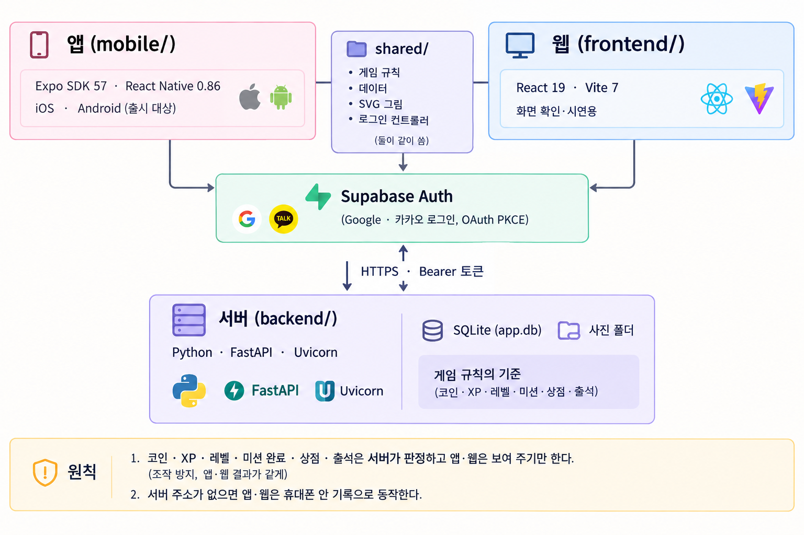

**원칙**: 코인·XP·레벨·미션 완료·상점·출석은 **서버가 판정**하고 앱·웹은 보여 주기만 한다(조작 방지, 앱·웹 결과가 같게). 서버 주소가 없으면 앱·웹은 휴대폰 안 기록으로 동작한다.

### 백엔드 구조

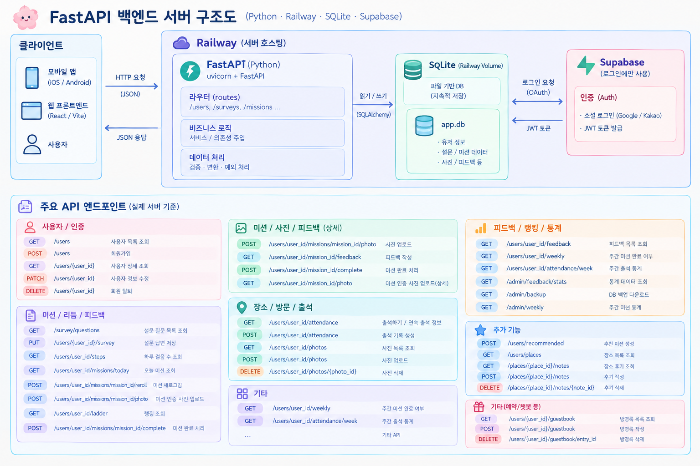

- **서버 주소**: https://mymochi-api-production.up.railway.app · API 문서 [/docs](https://mymochi-api-production.up.railway.app/docs)
- **서버**: FastAPI(Python) + uvicorn, Railway에서 실행. API 70개 전체는 [/docs](https://mymochi-api-production.up.railway.app/docs)·[backend/README.md](backend/README.md#api)
- **요청 흐름**: 앱·웹 → `access.guard`(토큰 없으면 401, 남의 `{user_id}`면 403) → `app/main.py` 라우트 → 규칙 모듈(`missions.py`·`shop.py`·`survey.py`…) → `app/db.py`
- **저장**: SQLite `app.db`(표 28개)와 사진 `uploads/`를 Railway Volume `/data`에
- **로그인**: Supabase Auth는 로그인(Google·카카오)과 JWT 발급만, 데이터는 서버 SQLite에

### 6-1. 사용한 도구

| 영역 | 도구 | 쓰는 곳 |
|---|---|---|
| 서버 | **FastAPI**, Uvicorn, Pydantic | API 70개, 요청 검사 (`backend/app/main.py`) |
| DB | **SQLite** (파이썬 내장 `sqlite3`) | 사용자·미션·코인 장부·사진·일기·방명록 등 28개 표 (`backend/app/db.py`, [DATABASE.md](backend/DATABASE.md)) |
| 이미지 | **Pillow**, pillow-heif | 촬영 일시(EXIF) 읽기, 위치 정보 지우기, HEIC → JPEG |
| HTTP | httpx | Supabase 토큰 확인·계정 삭제 |
| 데이터 분석 | pandas, numpy, openpyxl, Jupyter | 합성 데이터·SK 통신인구·신한카드 분석 (`data/`) |
| 테스트 | **pytest** (백엔드 277개), Node `node --test` (공통 134개), ESLint | `backend/tests/`, `shared/**/*.test.js` |
| 앱 | **Expo** (Router, Image Picker, Notifications, Secure Store, Web Browser, Clipboard, Build Properties), React Native, react-native-svg, AsyncStorage | `mobile/` |
| 앱 건강 | @kingstinct/react-native-healthkit + react-native-nitro-modules, react-native-health-connect | 걸음 수 (`mobile/src/health/`) |
| 앱 위치·지도 | **expo-location**, **react-native-maps** (iPhone Apple 지도 · Android Google 지도) | 동네 탐험 (`mobile/src/screens/Explore.jsx`, `explore/`) |
| 웹 | React, Vite | `frontend/` |
| 로그인 | **Supabase Auth** (@supabase/supabase-js) | Google·카카오 OAuth |
| 빌드·배포 | EAS (Expo Application Services) | 개발 빌드·APK (`mobile/eas.json`) |
| 협업 | GitHub, gh CLI, `.githooks/pre-commit` | PR 단위 작업, 비밀 값 커밋 막기 |

---

### 6-2. 기능마다

#### 로그인 · 계정

| 기능 | 어떻게 | 파일 |
|---|---|---|
| **Google·카카오 로그인** | Supabase Auth의 OAuth **PKCE** 흐름. 앱은 `expo-web-browser`로 로그인 창을 열고 `capstone-mochi://` 주소로 돌아와 코드를 세션으로 바꿈. 세션은 **SecureStore**(기기 보안 저장소)에 보관 | `mobile/src/auth/supabaseAuthCore.mjs`, `authClient.native.js`, `frontend/src/auth/authClient.js` |
| **서버 계정 연결** | 로그인 뒤 `POST /auth/supabase` — 서버가 토큰을 Supabase `/auth/v1/user`에 물어 진짜인지 확인 → Supabase 사용자와 서버 사용자 id를 이음. 처음이면 닉네임을 받아 가입 | `backend/app/auth.py`, `shared/auth/authBackendController.mjs` |
| **모든 API 토큰 확인** | FastAPI 앱 전체에 거는 의존성(`dependencies=[Depends(guard)]`). 주소의 `{user_id}` = 토큰 주인일 때만 허용(아니면 403). 남의 방에서 하는 일은 '하는 사람' 값을 토큰 주인과 비교. 같은 토큰은 60초 기억(해시로). 모드 `CAPSTONE_AUTH`: required / dev / off | `backend/app/access.py` |
| **앱·웹이 토큰 붙이기** | 로그인 컨트롤러를 만들 때 `accessToken()`을 API 모듈에 등록 → 모든 `call()`이 `Authorization: Bearer` 자동으로 | `mobile/src/api/server.js`, `frontend/src/api/missions.js` |
| **계정 삭제** | 설정 → 확인 창('삭제' 입력) → `DELETE /users/{id}`가 사용자 기록이 있는 25개 표와 사진 파일을 지우고, 관리자 키(`SUPABASE_SERVICE_ROLE_KEY`)가 있으면 Supabase 로그인 계정도 삭제 → 기기 기록·예약 알림 지우고 로그아웃 | `backend/app/main.py`, `mobile/src/screens/AccountDelete.jsx`, `frontend/src/components/AccountDelete.jsx` |
| **프로필** | 닉네임(중복·욕설 확인)·한 줄 소개·관심사, `PATCH /users/{id}` | `ProfileCard.jsx` (앱·웹) |

#### 미션

| 기능 | 어떻게 | 파일 |
|---|---|---|
| **미션 목록** | 91개를 JSON 한 파일로 관리(데일리 5 + 움직이기·집·찾아보기·기록·이어지기). 미션마다 종류(사진·걸음·글·방문·방명록…), 단계, 팁, 보상 규칙 | `backend/app/data/missions.json` |
| **오늘의 미션 고르기** | 사용자·날짜로 만든 난수(`random.Random(user:date)`)로 고름 → 같은 날 다시 열어도 같음. 어제 걸음(없으면 설문의 외출 빈도)으로 "안 나간 날 / 나간 날" 조합, 최근에 한 미션은 피함 | `backend/app/missions.py` `pick_missions` |
| **처음 설문** | 직업·관심 취미·외출 빈도 등. 모두 건너뛸 수 있고 미션 고르기에만 씀 | `backend/app/survey.py` |
| **단계 사다리** | 혼자 → 한 명 → 여럿(1~3단계). 지금 단계 미션 3번 하면 다음 단계, 내려가지 않음. 단계가 오를수록 코인 +5 | `missions.py` `LADDER` |
| **다른 미션으로 바꾸기** | 하루 3번, 같은 칸의 다른 미션으로 (보상을 다시 받지 않음) | `POST /missions/{id}/reroll` |
| **소감** | 완료 후 "해 보니 어땠어?" 1~5 이모지 + 한 줄 (행동 활성화) | `PUT /missions/{id}/feedback` |
| **주간 미션** | 자연 속 산책 사진, 서로 다른 날 2번 | `missions.py` `WEEKLY_QUESTS` |

##### 퀘스트 파일 위치

**서버가 정하고 판정**하고, 앱·웹은 서버 미션을 보여 주고 제출만 한다. 미션을 고치거나 추가할 때는 거의 `missions.json`과 `missions.py`만 보면 된다.

| 하는 일 | 서버 (`backend/`) | 앱 (`mobile/src/`) | 웹 (`frontend/src/`) |
|---|---|---|---|
| **미션 목록 (제목·종류·단계·팁·보상)** | `app/data/missions.json` (91개) | — | — |
| **오늘 미션 고르기 · 완료 판정 · 코인·XP · 레벨 · 단계 사다리 · 주간 미션** | `app/missions.py` (`pick_missions`, `is_complete`, `settle_coins`, `LADDER`, `WEEKLY_QUESTS`, `xp_for_next`) | — | — |
| **API (오늘 미션 · 바꾸기 · 사진 · 완료 · 소감 · 주간)** | `app/main.py` (`/users/{id}/missions/...`, `/users/{id}/weekly`) | `api/server.js` | `api/missions.js` |
| **사진 촬영 일시 확인 · 개인정보 지우기** | `app/photo_meta.py` | — | — |
| **출석** | `app/attendance.py` | `components/AttendanceCards.jsx` | `components/Attendance.jsx` |
| **퀘스트 화면 (오늘 · 이번 주 탭)** | — | `screens/quests/Quests.jsx` | `screens/Quest.jsx` |
| **서버 미션 카드 (사진 고르기 · 걸음 확인 · 했어요 · 이웃 가기 · 바꾸기)** | — | `screens/quests/ServerMissions.jsx` | `components/ServerMissions.jsx` |
| **사진 미션 · 미션 바꾸기 · 처음 취향 질문** | — | `screens/quests/PhotoMission.jsx`, `MissionReplacement.jsx`, `MissionPreferences.jsx` | `components/PhotoMission.jsx`, `MissionReplacement.jsx`, `MissionPreferences.jsx` |
| **보상 표시 (코인·XP 스티커, 받은 보상)** | — | `components/QuestRewards.jsx`, `RewardPanel.jsx` | `components/QuestRewards.jsx`, `RewardPanel.jsx` |
| **홈의 오늘의 도전 요약 · 끌어올리는 시트** | — | `screens/home/HomeScreen.jsx` | `screens/Home.jsx` |
| **테스트** | `tests/test_missions.py`, `test_reroll.py`, `test_api.py` | — | — |

서버 없이 쓰는 **개발용 미리보기**의 기기 안 미션은 `shared/`에 있다: `shared/data/missions.js`(미션 목록), `shared/features/dailyMissions.js`(데일리·일기·바꾸기), `shared/features/missionGuidance.js`(취향 추천·완료 기준), `shared/features/missionPhotos.js`, `shared/features/levelProgression.js`. 테스트는 같은 폴더의 `*.test.js`. 설계 근거는 [QUEST_DESIGN.md](QUEST_DESIGN.md), 규칙 한눈에 보기는 [docs/GAME_RULES.md](docs/GAME_RULES.md).

#### 사진 · 걸음 (확인되는 행동)

| 기능 | 어떻게 | 파일 |
|---|---|---|
| **사진으로 완료** | 앱은 `expo-image-picker`(카메라·앨범)로 고르고 `exif:true`로 촬영 일시를 같이 받음. 서버는 **파일의 EXIF 촬영 일시(DateTimeOriginal)를 먼저** 보고, 없으면 앱이 보낸 시각을 씀 → **미션 날짜(서울 기준)에 찍은 사진만 성공**. 카메라로 막 찍었는데 EXIF가 없으면 찍은 시각을 보냄 | `backend/app/photo_meta.py`, `mobile/src/screens/quests/ServerMissions.jsx` |
| **사진 개인정보** | 저장 전에 **위치(GPS)·기기 정보 등 메타데이터를 모두 지움**(Pillow로 다시 저장), 방향은 `exif_transpose`로 바로잡고 iPhone HEIC는 JPEG로, 긴 변 2048px. 주소는 추측할 수 없는 무작위 id | `photo_meta.clean_image` |
| **걸음 수** | iPhone은 **HealthKit**, Android는 **Health Connect**에서 하루 걸음 합계만 읽음(쓰지 않음). '걸음 수 연결하기' 한 번 → 권한 → 오늘+지난 7일을 `POST /steps`로. 이후 화면 열 때·'걸음 확인' 전에 자동. 서버가 이 값으로 '어제보다·지난주보다 1,000보 더' 목표를 정함. Expo 플러그인으로 권한 문구·Android 설정 자동 | `mobile/src/health/`, `mobile/app.json` |

#### 보상 · 성장 · 상점

| 기능 | 어떻게 | 파일 |
|---|---|---|
| **코인·XP·레벨** | 코인·XP는 **장부(coin_ledger)에 한 줄씩** 쌓고 합계로 계산(되돌리기·중복 방지 쉬움). 레벨 n → n+1에 필요한 XP = 100 + 35×(n−1) (LV.25 누적 12,060) | `db.py`, `missions.level_from_xp` |
| **경제 밸런스** | 상점 가격은 그대로, 미션 보상을 줄여 "사는 데 며칠 걸리나"로 맞춤 (Habitica 보상 공식·faucet/sink 설계 참고) — 밖 20·집 12·일기 15코인, 50 XP | [backend/ECONOMY.md](backend/ECONOMY.md) |
| **연속 출석** | 1일차 → 7일차 사다리. 출석 기록에서 **어제까지 이어진 연속 일수**를 세어 오늘 칸을 정함, 하루 빠지면 1일차, 7일차 다음은 새 바퀴. 7일차 특별 선물(옷·소품)은 사람·바퀴마다 정해진 난수, 가진 것이면 30코인 | `backend/app/attendance.py`, `AttendanceCards.jsx`(앱), `Attendance.jsx`(웹) |
| **상점** | 서버 카탈로그(친구 12 · 옷 9 · 집 꾸미기 46)와 앱 카탈로그가 같은지 테스트로 확인. 상품마다 상태(보유·살 수 있음·코인 부족·레벨 부족)를 서버가 계산 | `backend/app/data/shop.json`, `shared/data/*.js`, `backend/app/shop.py` |
| **캐릭터·옷 그림** | 모두 **SVG 코드**로 그림(이미지 파일 없음). 한 그림 코드를 웹(DOM)과 앱(react-native-svg)에 같이 쓰려고 그림 함수에 태그 묶음(`elements`)을 넘김. 땡땡이·줄무늬·체크·무지개 등 무늬는 SVG `<pattern>` | `shared/art/`, `shared/art/GarmentPattern.jsx` |
| **방 꾸미기** | 자리(벽지·바닥·소파·서랍장·커튼·전등·카페트·액자·인형·창밖 풍경)마다 하나씩. 벽지·바닥·러그 무늬도 같은 `GarmentPattern` | `RoomBackdrop`, `HouseDecor` (앱·웹) |
| **가구 옮기기** | 전등·액자·인형을 끌어서 옮김. 웹은 포인터 이벤트 + SVG 좌표 변환, 앱은 **PanResponder**(손가락 위치 차이 × 화면→그림 배율). 위치는 서버에 ±160 범위로 저장 → 이웃도 같은 배치로 봄 | `PUT /decor/{slot}/position`, `HomeScreen.jsx` |
| **방 안 시간** | 기기 시간으로 낮·밤 창밖 풍경, 달력·시계 | `shared/utils/roomTime.js` |

#### 기록

| 기능 | 어떻게 | 파일 |
|---|---|---|
| **일기** | 하루 한 편(서울 날짜), 기분 이모지, 지운 날은 다시 못 씀. 주제 50개를 사용자마다 섞어 날짜순으로 하나씩 → 50일 동안 겹치지 않음. 글 내보내기 | `backend/app/diary.py`, `diary_topics.json` |
| **위기 표현 확인** | 일기·미션 글에서 위기 표현 사전(출처·위험도 포함 103개)과 맞춰 봄. high는 바로 상담 안내(109), medium은 캐릭터 안부, low는 기록만. **진단이 아니라 도움을 건네는 장치**, 글 내용은 저장하지 않음 | `backend/app/crisis.py`, `crisis_lexicon.json` |
| **도움받을 곳** | 일기·설정에서 상담 기관 안내를 언제든 | `HelpResources.jsx` |
| **사진첩** | 미션으로 올린 사진을 달·미션 이름과 함께 | `GET /album` |
| **오늘의 문장** | 날짜마다 바뀌는 문장 | `shared/features/dailySentence.js` |

#### 이웃 · 친구

| 기능 | 어떻게 | 파일 |
|---|---|---|
| **이웃 추천** | 최근 7일에 앱을 쓴 사람 중 **내 레벨과 가까운 순**. '다른 이웃 보기'는 가까운 후보(보여 줄 수의 3배) 중 난수로 다른 조합 | `GET /rooms/recommended?refresh=n` |
| **방문·방명록** | 놀러 가면 TODAY/TOTAL 방문 수가 오르고 방문 미션이 자동 완료. 방명록 60자, 좋아요, 지우기 | `main.py` visits·guestbook |
| **친밀도** | 서로 한 방문 +1·방명록 +2·좋아요 +1(종류마다 하루 한 번)을 한 점수로 → 서로 오가야 빨리 오름. 친구 사이면 레벨업 때 둘 다 코인 | `backend/app/friendship.py` |
| **친구 코드** | 사용자마다 6자리(0·O·1·I 뺀 32글자, `secrets`로 생성, 겹치지 않게). 코드로 찾기 → 신청 → 상대가 수락. 상대가 먼저 신청했으면 바로 친구 | `db.new_friend_code`, `/friends/search`, `Friends` 탭 |
| **필터·신고·차단** | 욕설·비하·혐오 표현 목록으로 방명록·닉네임 막기(혐오 표현은 방명록 정지). 신고하면 신고한 사람에게 바로 숨김, 여러 명이 신고하면 모두에게 숨김, 새 계정 신고는 숨김 횟수에 안 셈. 차단하면 서로 안 보임 (Habitica 방식 참고, App Store 심사 1.2) | `backend/app/moderation.py`, `profanity.json`, 신고 창 |

#### 동네 탐험 (GPS)

| 기능 | 어떻게 | 파일 |
|---|---|---|
| **장소 목록·거리** | '내 위치로 보기'를 눌렀을 때만 위치 권한(`expo-location`, 앱 사용 중만) → 서버가 하버사인 공식으로 거리를 계산해 **가까운 순**. 위치는 거리 계산에만 쓰고 저장하지 않음 | `GET /places?lat=&lng=`, `backend/app/places.py`, `mobile/src/screens/Explore.jsx` |
| **지도** | `react-native-maps` — iPhone은 Apple 지도, Android는 Google 지도. 장소를 핀으로 | `mobile/src/screens/explore/PlaceMap.native.jsx` |
| **장소 쪽지** | 장소마다 140자 쪽지 + 종이 색·스티커. **읽기는 어디서나, 남기기는 장소 근처에서만**(서울도서관 60m · 서울광장 80m · 남산공원 300m, 위치 오차 50m 넘으면 판정 안 함). 앱과 서버가 같은 거리 판정, 방명록과 같은 욕설 필터·신고·차단 | `POST /places/{id}/notes`, `backend/app/data/places.json`, `mobile/src/screens/explore/PlaceNotes.jsx` |

#### 알림

| 기능 | 어떻게 | 파일 |
|---|---|---|
| **다시 부르기 알림** | `expo-notifications`로 **휴대폰 안에서 예약**(서버 불필요). 앱을 열 때·돌아올 때마다 예약을 지우고 2·4·7일 뒤 저녁 7시로 다시 잡음 → 계속 오는 사람에게는 안 울림. 친구 이름 + 받침에 맞는 조사(이/가) | `mobile/src/notify/` |

#### 개발 · 운영

| 기능 | 어떻게 | 파일 |
|---|---|---|
| **비밀 값 보호** | `.githooks/pre-commit`이 `.env`, Supabase secret·service_role 키, 개인 키, JWT, `backend/.env`의 실제 값이 커밋에 들어가면 막음 | `.githooks/pre-commit` |
| **시연 데이터** | 주인공 demo-mochi(3주 회복 이야기)와 이웃 3명을 만들어 줌 | `backend/scripts/seed_demo.py` |
| **휴대폰 접속** | 같은 와이파이에서 휴대폰으로 서버에 접속할 수 있게 실행 | `backend/scripts/serve.py` |
| **앱 미리보기** | Expo 웹(5183)을 휴대폰 크기 틀(5184)에 띄움 | `mobile/dev-preview/` |
| **디자인 시스템** | 공통 8색·글꼴(에이투지체)·간격 토큰을 앱·웹이 같이 씀 | `shared/theme/tokens.js`, [frontend/DESIGN_SYSTEM.md](frontend/DESIGN_SYSTEM.md) |

---

### 6-3. 출시 전 남은 일

1. Apple 로그인
2. 운영자 신고 확인 화면
3. 개인정보 처리방침·민감정보 동의
4. 만 14세 미만 처리
5. 실기기 빌드·테스트 (걸음 수·알림·로그인 후 앱 복귀 — 코드는 있음)
6. 스토어 등록 자료
7. 같은 사진 재사용 막기(사진 지문), 오류 모니터링

체크리스트는 [PROGRESS.md](PROGRESS.md) "출시 전 남은 일".

---

## 7. 문서

| 문서 | 내용 |
|---|---|
| [FEATURES.md](FEATURES.md) | **기능별로 무엇을 어떻게 만들었는지** (사용한 도구·라이브러리·파일) — 위 [6절](#6-기능별-구현)과 같은 내용 |
| [docs/GAME_RULES.md](docs/GAME_RULES.md) | **게임 규칙 기준표** — 미션·보상·레벨·상점·일기·저장, 서버가 최종 기준 |
| [APP_INTRO.md](APP_INTRO.md) | 앱 소개 — 왜 만들었나, 근거 연구, 비슷한 앱 조사, 원칙 |
| [MY_MOCHI_PRODUCT_GUIDE.md](MY_MOCHI_PRODUCT_GUIDE.md) | 제품 소개·발표·홍보용 가이드 (소개 문구, 피해야 할 오해) |
| [QUEST_DESIGN.md](QUEST_DESIGN.md) | 퀘스트 설계 근거 (행동 활성화, 사회 기술 팁, 단계 사다리) |
| [PROGRESS.md](PROGRESS.md) | 작업 기록과 **출시 전 남은 일** 체크리스트 |
| [INITIAL_PLAN.md](INITIAL_PLAN.md) | 초기 기획 (생활 리듬 기반 사회적 고립 조기 개입 AI 에이전트) |
| [backend/README.md](backend/README.md) | **서버** (FastAPI + SQLite) — 실행 방법, 시연용 데이터, 파일 구성, 전체 API 목록, 미션·보상·레벨 규칙, 상점·친밀도, 신고·차단·필터, 위기 표현 확인. 작업 기록은 [backend/CHANGELOG.md](backend/CHANGELOG.md) |
| [mobile/README.md](mobile/README.md) | **앱** (Expo · React Native, iPhone·Android) — 소스 구조, 로그인 연결, 퀘스트 안내, 걸음 수·건강 앱 연결, 다시 부르기 알림, 동네 탐험(위치·지도·장소 쪽지), 실행 방법, 저장 |
| [backend/DEPLOY.md](backend/DEPLOY.md) | **서버 배포** (Railway) — 환경변수, 순서, 확인, 백업 |
| [frontend/README.md](frontend/README.md) | **웹** (React + Vite) — 소스 구조, 로그인 연결, 퀘스트 안내, 색상·공통 UI, 화면별 기능(미션·일기·출석·상점·이웃), 실행·검증, 개발용 미리보기 |
